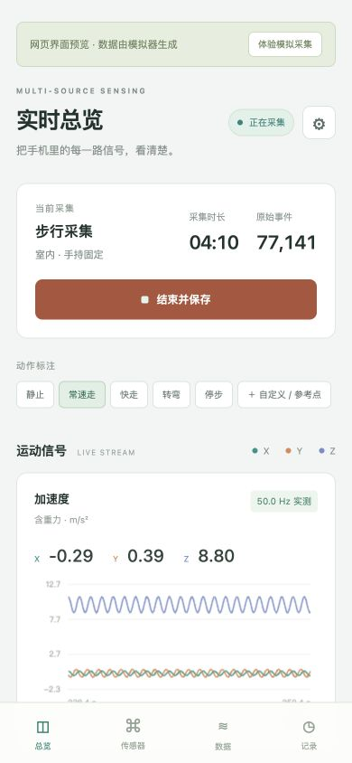
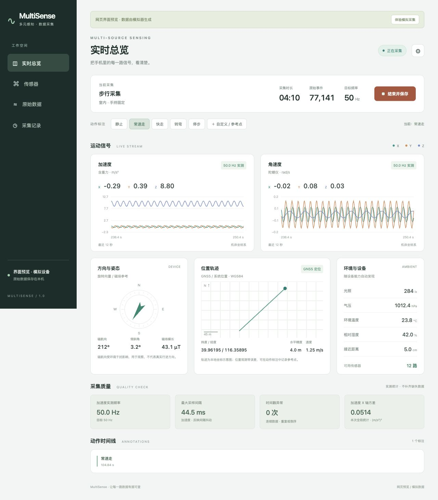

# MultiSense 多元数据采集

Android 手机多传感器采集 App，面向《多元感知融合》课程的采集实践。最低 Android 8.0。界面、记录和图示离线运行，数据保存在本机，导出由用户选择保存位置。

Android multi-sensor and GNSS data collector for teaching and field experiments. Records raw events locally and exports complete sessions as ZIP files.

- 多传感器异步记录，保留完整向量和纳秒时间戳。
- GNSS 位置、卫星状态、NMEA 与设备支持的原始测量。
- 实时波形、动作/参考点标注、历史回看和 CSV/JSONL 导出。
- 原生 Android 采集服务与本地 WebView 界面，无账号和云端依赖。

## 界面预览

以下截图来自网页模拟采集，用于展示界面。





## 安装和使用

[下载调试 APK](https://github.com/LiaHon/MultiSense/raw/refs/heads/main/outputs/MultiSense-debug.apk)，或从本仓库 `outputs/MultiSense-debug.apk` 安装。这是用于课程试采和真机验证的调试签名版本，版本号为 `1.1.2`。Android 安装器可能需要允许当前下载应用安装未知来源应用。

1. 打开 App，在右上角设置记录名称、默认场景与动作、手机姿态及目标采样率（100/200 Hz，默认 200 Hz）。可在“自定义场景与动作”中增删或重命名选项。手机姿态在采集期间锁定。
2. 在“传感器”页查看手机实际提供的数据源，默认全选。可选择是否同时记录 GNSS、Wi-Fi、BLE 与蜂窝基站。
3. 点击“开始采集”，按系统提示授予相关权限；未授权或不支持的数据源会显示提示，其余数据仍可采集。
4. 查看三轴波形、方向仪、位置轨迹、环境读数、卫星强度和实测频率。选择场景或动作后点击“确认切换”才会生效；点击“取消”放弃待确认选择。独立打点只记录瞬间事件，可填写已知参考点的 WGS84 经纬度。
5. 点击“结束并保存”，本次记录独立保存。进入“采集记录”可回看图表、逐页查看完整原始事件、导出包含状态区间和数据说明的 ZIP。通知栏也可结束并保存。

界面显示 20 分钟目标、动作状态种类及独立打点记录。正式通勤采集应连续不少于 20 分钟，包含至少 3 种真实运动状态，并记录 2–3 个关键事件；手机携带位置需与设置一致。

建议首次在前台采集 40 秒：静止 10 秒、常速踏步 20 秒、快速踏步 10 秒；保存后检查 CSV。再做室外行走、转弯、停步和锁屏试采，确认自己的手机允许持续记录。

## 采集范围

App 自动枚举 `SensorManager.TYPE_ALL` 返回的所有开放传感器。既记录硬件传感器，也记录系统合成传感器，同类型的多个实例单独编号。范围可包含三轴加速度、陀螺仪、磁力计、未校准数据、重力、线性加速度、旋转向量、光照、气压、距离、温湿度、步态、步数和设备提供的其他传感器。单次触发传感器使用 TriggerEventListener，触发后重新注册。

同时支持系统位置/GNSS 经纬度、高度、速度、航向及可用的精度字段、卫星状态、NMEA、设备支持的 GNSS 原始测量与接收机时钟。设备能力与系统权限决定实际范围；例如大多数手机没有温湿度或心率硬件。App 不会为缺失的数据源伪造测量值。

射频观测独立写入 `network.csv`：Wi-Fi 每 30 秒调用 startScan，接收成功的新扫描结果，保留 BSSID、SSID、RSSI、频率和源时间；BLE 持续扫描，每设备最多记录 1 Hz，保存 MAC、RSSI、广播原始字节；蜂窝监听基站变化并每 30 秒请求更新，保存基站身份、制式及信号强度。相同源时间的缓存观测不会重复计数，也不会将采集开始前的结果写成新观测。

Wi-Fi、BLE 和蜂窝默认启用，可在设置中关闭。需要精确定位权限及系统定位开关；Android 12+ 的 BLE 另需附近设备权限；蜂窝变化监听另需“电话”权限（READ_PHONE_STATE）。拒绝电话权限或监听注册失败时仍尝试每 30 秒获取基站更新，实际可用性由系统决定。Wi-Fi / 蓝牙需开启对应扫描能力，蜂窝依赖模块及运营商支持；不可用原因显示在“传感器”页，并记录到 manifest。Wi-Fi 扫描受 Android 节流约束，BLE 在息屏、后台也可能被系统暂停，实际结果以真机为准。摄像头和麦克风不在本次作业的传感器清单内，本版未实现。

前台采集服务使用持续通知和 CPU 唤醒锁，支持将界面切到后台。不同手机的电池管理、权限和传感器策略可能导致中断；目前未连接 Android 真机，后台采集与 GNSS 行为仍需实测。不要在采集时强行停止 App 或关机。若进程意外退出，最后一次已刷新的原始数据仍保留，记录会标为“未完整结束”；最后约 2 秒缓冲可能未写完。

## 文件和时间规范

每次记录包含以下文件，ZIP 原样打包它们：

| 文件 | 内容 |
| --- | --- |
| `manifest.json` | 设备与传感器清单、单位、量程、版本、场景、携带姿态、目标/实测频率、计数、最大间隔、异常和完成状态 |
| `samples.jsonl` | 全部原始事件，含任意长度完整传感器向量、GNSS 原始测量、动作标签 |
| `sensors.csv` | 每次传感器事件；`v0`–`v5` 便于分析，`values_json` 保存完整向量，包括超过 6 维的数据；`scene` / `action` 为生效的场景与动作 |
| `locations.csv` | 异步系统位置观测及精度，缺失字段留空 |
| `satellites.csv` | 可见卫星、星座、C/N0、仰角、方位角及参与定位标志 |
| `nmea.csv` | NMEA 语句与收到时刻、源墙钟时间 |
| `markers.csv` | 独立事件及参考点的时间、名称、备注和可选参考坐标 |
| `states.csv` | 第 0 秒初始状态及每次确认生效的场景、动作和时间 |
| `network.csv` | Wi-Fi / BLE / 蜂窝分行保存，含源时间、地址/基站身份、RSSI 与完整 details_json |
| `labels.csv` | 无表头，每行 `起始秒,结束秒,状态名`，从第 0 秒覆盖至停止时间，左闭右开 |
| `data_spec.md` | 设备、携带位置、时长、通道清单及各路全程实测频率 |
| `collection_check.json` | 20 分钟、≥3 种状态、运动通道 ≥100 Hz 采集检查；不包含分析任务的完整 self_test |

运动核心通道（加速度、角速度、线性加速度、重力）请求 100/200 Hz；未校准加速度/角速度使用同档，磁场请求 50 Hz，旋转向量请求 100 Hz，慢变量使用 SENSOR_DELAY_NORMAL（变化/事件型保留系统触发）。`requestedPeriodUs` 记录逐通道请求周期。实测 `sessionHz = count / durationS` 与界面和规格说明一致；`hz` 另保留首末样本间隔估计，`maxGapMs` 和 `nonMonotonic` 用于连续性核验。目标频率不保证实际达标。

确认切换后，新的场景与动作从现在起生效；重复确认同一状态不会新增记录。仅切换场景会写入 `states.csv`，不会拆分 `labels.csv` 中的动作区间；独立打点也不会拆段。停止时自动关闭最后一段。旧版记录回看会从初始动作和原有状态标注恢复区间，原始文件保持不变。请核对导出的 labels.csv 与真实过程一致；漏标可在导出后人工修订，不应伪造或拼接数据。异常退出时标签末段可能尚未闭合，采集记录会保留未完整结束状态。

传感器和位置保留系统原始 elapsed realtime 纳秒时间戳；NMEA/卫星回调使用接收时间并单独保留可用的源时间。JSON 中 `t` 和 GNSS 长整型纳秒字段使用十进制字符串，避免 JavaScript 对 64 位整数舍入。CSV `elapsed_ns` 为十进制整数。`s` 是相对采集起点的秒数；`wall` 从采集起点的墙钟与单调时间推算，避免中途校时影响时间轴。传感器彼此异步，不强制重采样，也不以零值填补缺失。

坐标：传感器采用 Android 机体系，X 向屏幕右侧、Y 向手机顶部、Z 向屏幕外；GNSS 为 WGS84。加速度含重力，单位 m/s²；角速度为 rad/s；磁场为 µT。特殊传感器的向量各元素定义请按 `stringType` 查 Android 文档，例如未校准传感器后半段为偏置估计、旋转向量为四元数分量。方向仪的磁航向用于观察，不等于人的行进方向；轨迹图是本地米制示意图。

图表只保留显示用的有限窗口，原始记录持续写入文件。历史图表全段抽样显示；“原始数据”页以每页 100 事件读取完整记录；ZIP 导出保留全部原始事件。

## 构建

克隆仓库后，用 Android Studio 打开项目：

```sh
git clone https://github.com/LiaHon/MultiSense.git
cd MultiSense
```

使用 JDK 17，安装 Android SDK Platform 35 和 Build Tools 35.0.0，配置不提交到 Git 的 `local.properties`：

```properties
sdk.dir=/你的/Android/sdk
```

```sh
./gradlew assembleDebug
./gradlew lintDebug
```

APK 位于 `app/build/outputs/apk/debug/app-debug.apk`。无额外 App 依赖，Gradle 插件为 8.7.3，Gradle 为 8.9。默认使用本机 Android 调试签名；可通过 `MULTISENSE_DEBUG_KEYSTORE` 指定已有调试 keystore。分发到 `outputs/` 的 APK 必须使用原发布签名，具体校验步骤见 [开发与验证说明](docs/DEVELOPMENT.md#发布调试-apk)。

Windows 使用 `gradlew.bat assembleDebug` 和 `gradlew.bat lintDebug`。

## 网页界面预览

```sh
python3 preview/server.py --port 8765
```

打开 `http://127.0.0.1:8765`，点击“体验模拟采集”。网页预览明确标识模拟数据，演示记录只保存在当前页面内存中。预览适配器不打包进 APK；实际传感器采集必须使用 Android App。

## 验证

存储测试需 JDK 17 和 Maven Central 的 `org.json:json:20240303`：

```sh
curl -fL https://repo.maven.apache.org/maven2/org/json/json/20240303/json-20240303.jar -o /tmp/multisense-json.jar
MULTISENSE_JSON_JAR=/tmp/multisense-json.jar sh scripts/test-storage.sh
```

也可以使用已下载的依赖：

```sh
MULTISENSE_JSON_JAR=/路径/json-20240303.jar sh scripts/test-storage.sh
```

测试覆盖逐类采样策略、完整向量和时间戳保存、两种实际采样率口径、间隔与异常统计、状态区间衔接、事件/状态区分、射频 CSV、采集检查、完整 ZIP、历史分页及异常退出后的残缺尾行读取。浏览器验证覆盖开始、标注、停止保存、历史回看、分页、ZIP 导出、手机和桌面布局。浏览器验证使用模拟数据，不能替代真机传感器测试。

参考实现依据：[Android 传感器概览](https://developer.android.com/develop/sensors-and-location/sensors/sensors_overview)、[GNSS 原始观测](https://developer.android.com/develop/sensors-and-location/sensors/gnss)、[前台服务类型](https://developer.android.com/about/versions/14/changes/fgs-types-required)。

按 [HW1 作业要求](http://10.112.165.210:9000/multi_source_fusion/docs/hw1_assignment.html) 的实现对照与真机验收步骤见 [docs/HW1_REQUIREMENTS.md](docs/HW1_REQUIREMENTS.md)。

### 1.1.1 蜂窝权限修复

修复 1.1.0 漏声明/申请 READ_PHONE_STATE 导致 cell 显示“权限被拒绝或已撤销”的问题。覆盖安装新版，启用蜂窝采集后允许系统的“电话”权限及精确位置。若曾拒绝且不再弹窗，可进入系统设置 → 应用 → MultiSense → 权限调整，然后重新开始采集。电话权限仅在启用蜂窝且设备有蜂窝模块时申请；程序只监听基站信息。未获电话权限时会提示仅进行定时更新，监听失败不再阻断定时更新。
